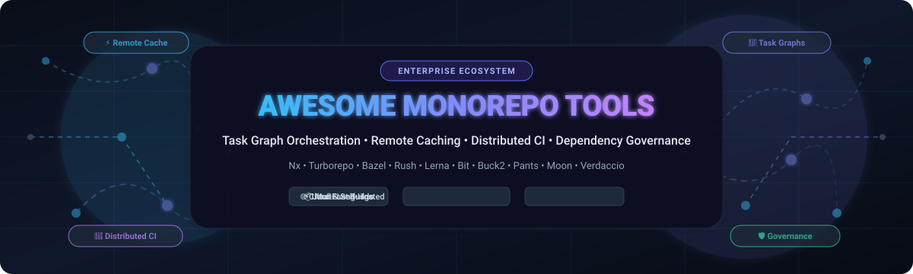

  

       

---

# 🚀 Awesome Monorepo Tools: The Definitive Ecosystem Directory

> 🌐 **The comprehensive, curated guide to Monorepo Build Systems, Task Graph Orchestrators, Remote Caching Solutions, and Dependency Governance Platforms.**

Welcome to the ultimate directory of **Monorepo Tools** designed for platform engineers, infrastructure architects, and developer productivity teams. Whether you are scaling a multi-package JavaScript/TypeScript repository, coordinating polyglot enterprise microservices, or implementing hermitically sealed builds with remote build execution (RBE), this guide indexes the leading SaaS platforms and open-source tools with transparent metrics on pricing, free-tier limits, market valuation, and GitHub popularity.

---

## 📑 Table of Contents

- [📊 Sector Overview & Market Dynamics](#-sector-overview--market-dynamics)
- [🏢 SaaS & Hosted Commercial Platforms](#-saas--hosted-commercial-platforms)
- [🛠️ Open-Source GitHub Projects](#️-open-source-github-projects)
- [🧩 Workspace Package Managers & Foundation Tools](#-workspace-package-managers--foundation-tools)
- [🎯 Architecture & Tool Selection Matrix](#-architecture--tool-selection-matrix)
- [🤝 How to Contribute](#-how-to-contribute)
- [💖 Support & Sponsorship](#-support--sponsorship)
- [📈 Star History](#-star-history)
- [📜 Disclaimer](#-disclaimer)

---

## 📊 Sector Overview & Market Dynamics

The global market for software development tools, build automation, and continuous delivery orchestration is currently estimated at **$6.4 billion to $8.6 billion** (2025–2026), expanding rapidly at a compound annual growth rate (**CAGR**) of **14% to 16%** toward an anticipated **$18 billion+ by 2032**. 

From a competitive landscape perspective, the sector exhibits **moderate fragmentation with distinct tier-based concentration**:
- **Artifact Repositories & Registries:** Highly concentrated around established enterprise heavyweights (e.g., JFrog and Sonatype), which command dominant market share in software supply chain governance and universal artifact distribution.
- **Task Graph Orchestration & Remote Build Caching:** Moderately fragmented and intensely competitive. Specialized JavaScript/TypeScript-focused task orchestrators (such as Turborepo and Nx) dominate modern web and cloud-native application stacks, while language-agnostic hermetic systems (such as Bazel, Buck2, and Pants) service large-scale multi-language enterprise codebases requiring deterministic compilation and distributed execution.

---

## 🏢 SaaS & Hosted Commercial Platforms

Below is a detailed breakdown of top commercial SaaS and managed platforms for monorepo remote caching, CI acceleration, and enterprise artifact governance. Tiers are sorted in descending order by **Company Scale (Valuation / Market Capitalization / Annual Revenue)**.

| 🏢 Platform | 💰 Starting Tier Pricing | 🆓 Free Tier Limit | 📈 Company Scale (Valuation / Revenue) | 🌟 Key Focus & Core Monorepo Capabilities |
| :--- | :--- | :--- | :--- | :--- |
| **[JFrog Artifactory](https://jfrog.com/artifactory/)** | **$98/month** *(Pro Cloud monthly plan with 25 GB storage & transfer)* | **Free forever plan:** Includes **2 GB storage** and **10 GB/month data transfer** supporting npm, Maven, Docker, and PyPI | **~$11.1B Market Cap** *(Public: NASDAQ `FROG` · ~$531.8M ARR in 2025)* | Universal binary & package repository manager supporting 30+ package formats, enterprise multi-site replication, and security compliance. |
| **[Vercel Remote Cache](https://vercel.com/docs/monorepos/remote-caching)** | **$20/seat/month** *(Vercel Pro plan with team concurrency & analytics)* | **Free forever plan (Hobby):** Includes **100 GB/month cache upload limit** and **100 artifact requests/minute** for personal non-commercial projects | **$3.25B Valuation** *(Series E · $250M raised · ~$100M+ ARR)* | Managed zero-config remote build cache tailored for Turborepo and Next.js applications, sharing build and test outputs seamlessly across developers and CI pipelines. |
| **[Sonatype Nexus](https://www.sonatype.com/products/nexus-repository)** | **$162.50/month** *($1,950/year billed annually for Nexus Repository Cloud Pro)* | **14-day free trial** with full Pro cloud features; or **Free forever Community Edition** *(self-hosted, capped at 40,000 components & 100,000 requests/day)* | **~$1.5B Valuation** *(Acquired by Vista Equity Partners · ~$150M+ ARR)* | Industry-standard enterprise artifact repository manager and steward of Maven Central, featuring governance policies and supply chain security controls. |
| **[Cloudsmith](https://cloudsmith.com/)** | **$149/month** *(Pro Plan with 100 GB storage & 250 GB bandwidth)* | **Free forever plan (Core):** Capped at **500 MB artifact storage** and **1 GB/month package delivery bandwidth** *(higher allocations for open source)* | **~$300M Valuation** *($133M total venture funding raised through Series C in 2026)* | Cloud-native universal package management platform with global CDN acceleration, 28+ package formats, and provenance tracking. |
| **[Nx Cloud](https://nx.app/)** | **$29/month base** *(Team Plan with 50,000 base credits + $5.50/10k additional credits)* | **Free forever plan (Hobby):** Includes **50,000 credits/month**, **5 contributors**, and **10 concurrent CI connections** *(100% free unlimited for public OSS repos)* | **~$75M – $100M Valuation** *($24.6M raised from a16z & Nexus VP · ~$31M ARR)* | Dynamic task graph scheduling, remote caching, distributed task execution (Nx Agents), and automatic flaky-task retry engine for polyglot Nx monorepos. |
| **[Bit Cloud](https://bit.cloud/)** | **$25/month** *(Professional Plan with 250 credits/month & private scopes)* | **Free forever plan:** Includes **25 credits/month**, unlimited public component scopes, component dependency graph hosting, and basic Ripple CI | **~$70M – $90M Valuation** *($36M total venture funding raised led by Insight Partners)* | Component-driven monorepo platform with autonomous scopes, Ripple CI for cross-component dependency build propagation, and component registry hosting. |

---

## 🛠️ Open-Source GitHub Projects

The leading open-source monorepo tools, task graph orchestrators, and hermetic build engines. Sorted in descending order by **GitHub Stargazer Count**.

### 1. [Lerna](https://github.com/lerna/lerna) 
- **License:** MIT ⚖️
- **Primary Languages:** JavaScript, TypeScript
- **Description:** The pioneer of JavaScript monorepo management, maintained by Nrwl (Nx team). Modern Lerna v7+ delegates dependency resolution and local symlinking directly to underlying package managers (pnpm, yarn, npm) while focusing on high-speed task execution, project graph visualization, automated semantic versioning, conventional commits, and multi-package npm publishing workflows (`lerna publish`).
- **Best For:** Teams seeking battle-tested, coordinated package versioning, changelog generation, and multi-package distribution to npm/registries.

### 2. [Turborepo](https://github.com/vercel/turborepo) 
- **License:** MIT ⚖️
- **Primary Languages:** Rust, Go, TypeScript
- **Description:** A high-performance build system written in Rust designed by Vercel for JavaScript and TypeScript codebases. Features lightning-fast incremental computation, fingerprint-based task caching, declarative configuration (`turbo.json`), intelligent task filtering (`--filter`), and remote cache synchronization that turns multi-minute CI builds into near-instant cache hits.
- **Best For:** JavaScript and TypeScript teams wanting maximum speed with minimal configuration overhead and seamless Vercel integration.

### 3. [Nx](https://github.com/nrwl/nx) 
- **License:** MIT ⚖️
- **Primary Languages:** TypeScript, JavaScript, Rust
- **Description:** An extensible, enterprise-grade build framework with deep task graph orchestration, native code generators, dependency graph analysis, and module boundary lint rules (`@nx/enforce-module-boundaries`). Supports polyglot architectures via official and community plugins for React, Angular, Node, Vue, Next.js, Go, Rust, Java, and Python.
- **Best For:** Medium to large-scale engineering organizations managing 50+ projects needing architectural guardrails, automatic dependency enforcement, and distributed CI execution.

### 4. [Bazel](https://github.com/bazelbuild/bazel) 
- **License:** Apache-2.0 ⚖️
- **Primary Languages:** Java, C++, Starlark
- **Description:** Google's open-source version of its internal Blaze build system. Provides hermetic, fully reproducible, and language-agnostic builds across massive multi-gigabyte repositories. Bazel traces exact inputs and outputs for every build action, enabling bit-for-bit reproducible artifacts, distributed remote caching, and massive parallelization via Remote Build Execution (RBE).
- **Best For:** Massive polyglot enterprise codebases (C++, Java, Go, Python, Rust) requiring strict hermeticity, reproducible builds, and multi-machine distributed build clusters.

### 5. [Bit](https://github.com/teambit/bit) 
- **License:** Apache-2.0 ⚖️
- **Primary Languages:** TypeScript, JavaScript
- **Description:** A component-driven build and composition toolchain that elevates individual components—rather than monolithic package directories—to the primary unit of software development. Bit tracks dependencies per-component, enables independent versioning and testing, and allows seamless cross-application sharing without requiring separate repositories.
- **Best For:** Design system teams, micro-frontend architectures, and component-first web development.

### 6. [Verdaccio](https://github.com/verdaccio/verdaccio) 
- **License:** MIT ⚖️
- **Primary Languages:** TypeScript, JavaScript, Node.js
- **Description:** A lightweight, self-hostable private npm registry and proxy cache with zero configuration required. Verdaccio acts as a transparent caching proxy for the public npm registry, ensuring that local packages, monorepo dependencies, and end-to-end integration tests run without external network delays or registry outages.
- **Best For:** Self-hosted private npm package hosting, CI local caching, and offline monorepo development.

### 7. [Changesets](https://github.com/changesets/changesets) 
- **License:** MIT ⚖️
- **Primary Languages:** TypeScript, JavaScript
- **Description:** A multi-package versioning and changelog management tool tailored specifically for monorepos. Changesets allows developers to declare intent-based version bumps with markdown change fragments attached directly to pull requests, enabling automated CI releases, synchronized version increments, and clean changelog compilation.
- **Best For:** Open-source monorepos, multi-package library authors, and teams pairing with Turborepo or pnpm workspaces.

### 8. [Earthly](https://github.com/earthly/earthly) 
- **License:** BSL-1.1 / Open-Core ⚖️
- **Primary Languages:** Go
- **Description:** A container-based build tool that fuses the syntax of Dockerfile and Makefile into an isolated, reproducible build pipeline (`Earthfile`). Every monorepo build step executes in an isolated container sandbox with instant layer-level caching, guaranteeing that builds behave identically on developer laptops and CI runners.
- **Best For:** Polyglot monorepos needing container-level isolation, unified local-to-CI parity, and granular layer caching.

### 9. [Rush](https://github.com/microsoft/rushstack) 
- **License:** MIT ⚖️
- **Primary Languages:** TypeScript
- **Description:** Microsoft's enterprise monorepo orchestrator engineered for extreme scale and rigid dependency governance. Used internally on high-profile Microsoft products (such as Office 365 web apps and Azure SDKs), Rush enforces explicit dependency registration in `rush.json`, deterministic package installation via pnpm, phased builds, and reviewed package additions.
- **Best For:** Large enterprise engineering organizations requiring strict dependency governance, deterministic installations, and controlled publishing workflows.

### 10. [Tuist](https://github.com/tuist/tuist) 
- **License:** MIT ⚖️
- **Primary Languages:** Swift
- **Description:** The premier command-line tool for managing, generating, and scaling large Xcode projects and Apple ecosystem monorepos. Tuist generates modular Xcode projects on demand from declarative Swift manifests, eliminates project merge conflicts, and integrates remote binary artifact caching to slash Xcode compilation times.
- **Best For:** iOS, macOS, watchOS, and visionOS development teams scaling large Apple platform codebases.

### 11. [Buck2](https://github.com/facebook/buck2) 
- **License:** Apache-2.0 / MIT ⚖️
- **Primary Languages:** Rust, Starlark
- **Description:** Meta's next-generation polyglot build system rewritten from scratch in Rust. Buck2 separates the build engine core from language rules (written in Starlark), incorporates a virtual file system (EdenFS integration), and natively targets Remote Build Execution (RBE) with low memory footprint and sub-second evaluation.
- **Best For:** High-scale multi-language enterprise repositories looking for modern, memory-safe alternatives to Bazel with superior remote build execution speed.

### 12. [Moon](https://github.com/moonrepo/moon) 
- **License:** MIT ⚖️
- **Primary Languages:** Rust, TypeScript
- **Description:** A next-generation monorepo build system and repository management tool written in Rust by moonrepo. Designed for developer ergonomics, Moon provides native toolchain management (proto integration), incremental build hashing, task inheritance, automated Dockerfile generation, and multi-language support (JavaScript, TypeScript, Rust, Python, Go).
- **Best For:** Modern web and polyglot teams wanting built-in language toolchain versioning combined with blazing Rust task execution.

### 13. [Pants](https://github.com/pantsbuild/pants) 
- **License:** Apache-2.0 ⚖️
- **Primary Languages:** Python, Rust
- **Description:** A fast, scalable, and ergonomic build system specifically optimized for Python, Go, Java, Scala, and Kotlin monorepos. Pants v2 combines a high-speed asynchronous engine written in Rust with dynamic Python rule definitions, automatic dependency inference (no manual target wiring required), and fine-grained remote caching.
- **Best For:** Python-heavy enterprise monorepos, data science platforms, and polyglot backend engineering teams.

### 14. [Lage](https://github.com/microsoft/lage) 
- **License:** MIT ⚖️
- **Primary Languages:** TypeScript, JavaScript
- **Description:** Microsoft's lightweight, task-based monorepo runner tailored for JavaScript and TypeScript workspaces. Lage offers topological pipeline scheduling, npm script orchestration, worker thread parallelization, and local/remote cache integration with minimal configuration surface.
- **Best For:** Teams already using npm, yarn, or pnpm workspaces looking for an un-opinionated, lightweight task cache runner.

---

## 🧩 Workspace Package Managers & Foundation Tools

Modern monorepo task runners sit on top of underlying package managers that handle package resolution, link trees, and shared hoisting:

- **[pnpm Workspaces](https://pnpm.io/workspaces)** 📦 — Fast, disk space-efficient package manager utilizing a content-addressable hard link store. The industry standard backing tools like Turborepo, Rush, and Bit.
- **[Yarn Workspaces](https://yarnpkg.com/features/workspaces)** 🧶 — Native multi-package workspace management supporting Plug'n'Play (PnP) zero-installs and modular plugins.
- **[npm Workspaces](https://docs.npmjs.com/cli/using-npm/workspaces)** 📄 — Built-in native multi-package management supported in npm v7+.

---

## 🎯 Architecture & Tool Selection Matrix

| Tool | Core Philosophy | Primary Languages | Configuration Overhead | Remote Cache Support | Distributed Execution (CI) | Module Boundary Enforcement |
| :--- | :--- | :--- | :--- | :--- | :--- | :--- |
| **Turborepo** | Minimal config, high speed | JS, TS | 🟢 Very Low (`turbo.json`) | 🟢 First-party (Vercel) & self-hostable | 🟡 Via external runners | 🔴 External linter required |
| **Nx** | Comprehensive platform | Polyglot (JS, TS, Java, .NET, Go, Rust) | 🟡 Moderate (`nx.json`, plugins) | 🟢 First-party (Nx Cloud) & custom | 🟢 First-party (Nx Agents / DTE) | 🟢 First-party `@nx/enforce-module-boundaries` |
| **Bazel** | Hermetic, bit-for-bit reproducible | Polyglot (C++, Java, Go, Rust, Python, etc.) | 🔴 High (`BUILD.bazel`, `WORKSPACE`) | 🟢 First-party (HTTP/gRPC) & BuildBuddy | 🟢 Native Remote Build Execution (RBE) | 🟢 Package visibility rules |
| **Rush** | Strict enterprise governance | JS, TS (pnpm-first) | 🔴 High (`rush.json`, phased builds) | 🟡 Cloud/Self-hosted (Experimental) | 🟡 Cobuilds (Experimental) | 🟢 Enterprise package review gates |
| **Bit** | Component-first composition | JS, TS, React, Vue | 🟡 Moderate (Component scopes) | 🟢 Bit Cloud & distributed Ripple CI | 🟢 Ripple CI distributed component builds | 🟢 Component scope boundaries |
| **Pants** | Auto-inferred dependencies | Python, Go, JVM | 🟢 Low-Moderate (Auto-inferred) | 🟢 Local & Remote Cache (gRPC) | 🟢 Native dynamic execution engine | 🟢 Fine-grained target scopes |

---

## 🤝 How to Contribute

We welcome additions, corrections, and updates from the developer community! 🌟

1. **Fork the repository** to your GitHub account.
2. **Create a descriptive branch:** `git checkout -b feature/add-new-monorepo-tool`.
3. **Add or edit entries in `README.md`** following the existing table or list format.
4. **Ensure high data accuracy:** Include specific tier prices, clear free tier limits, official links, and factual descriptions.
5. **Submit a Pull Request** with a concise summary of changes.

---

## 💖 Support & Sponsorship

Thank you for visiting and using **Awesome Monorepo Tools**! If this curated index saves you time, helps your engineering team choose the right build architecture, or accelerates your CI pipelines, please consider supporting the project:

- ⭐ **Star this repository** to help other developers discover it!
- 🍴 **Fork and share** with your DevOps, platform, and infrastructure teams.
- ☕ **Support the maintainer directly:** Help fund ongoing maintenance, benchmarks, and ecosystem research via the [GitHub Sponsor Dashboard](https://github.com/sponsors/ishandutta2007).

  

---

## 📈 Star History

---

## 📜 Disclaimer

- This repository is an independent, **community-curated directory** intended for technical evaluation and architectural comparison. Product names, logos, and brands are property of their respective owners.
- Monorepo tooling architectures differ significantly in caching semantics, task scheduling models, and configuration complexity. Remote caching without branch-level isolation or proper secret stripping can lead to security leakages or cache cross-contamination. Always benchmark build performance and verify security isolation parameters within your own organizational infrastructure.

---

  <b>Built with ❤️ for platform engineers, infrastructure architects, and developer productivity teams worldwide.</b> 
  Let's make monorepo builds lightning fast, hermetic, and effortless to govern.

